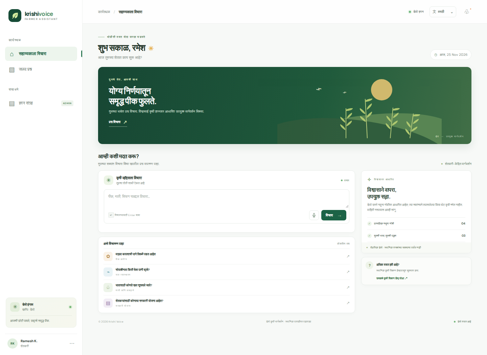
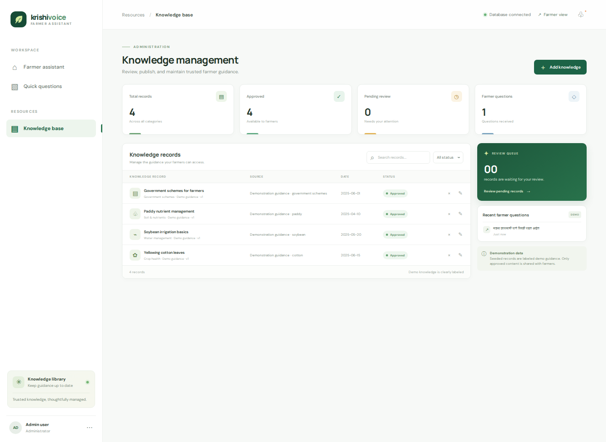
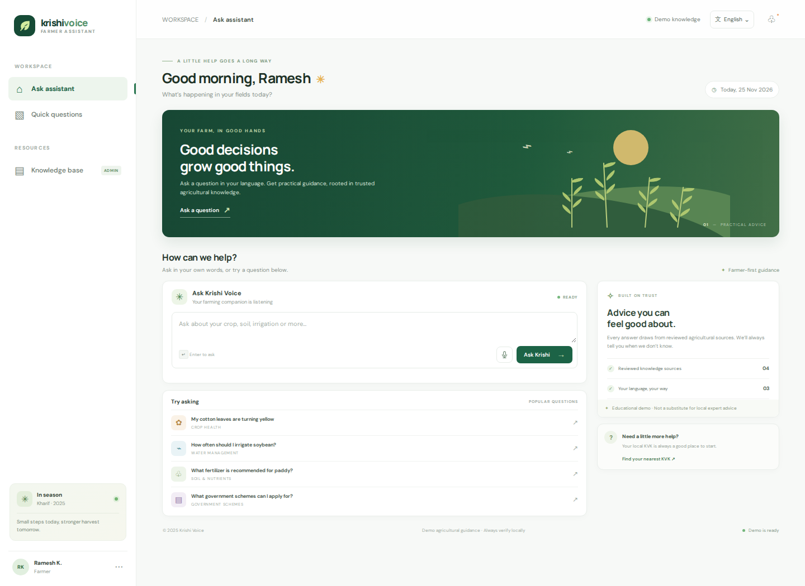

# Krishi Voice — AI Farmer Assistant

Krishi Voice is an academic, local-first prototype for multilingual agricultural
guidance. It pairs a responsive HTML/CSS/vanilla JavaScript interface with a
FastAPI service and a persistent SQLite knowledge base. It uses no generative AI
model, paid API, or external AI dependency.


## Run

```bash
python -m pip install -r requirements.txt
bash scripts/start.sh
```

Open [http://localhost:8000](http://localhost:8000) for the farmer interface,
[/admin](http://localhost:8000/admin) for the admin dashboard, and
[/docs](http://localhost:8000/docs) for the interactive OpenAPI page. The
database is created and seeded on first start at `data/smartkisan.db`. Set
`SMARTKISAN_DB` to use another SQLite file.

## GitHub Codespaces

The dev container installs dependencies and forwards port **8000**. Start the
app with `bash scripts/start.sh`, then open port 8000 from the **Ports** tab.
See [docs/deployment.md](docs/deployment.md).

## Screenshots

### Farmer interface — Marathi



### Admin dashboard



### Farmer interface — English



The screenshots show the seeded demonstration interface at a 1440 × 1050
desktop viewport. To capture an updated Marathi view, open `/?lang=mr`.

## Features

- English, Hindi, and Marathi interface labels and seeded answers.
- Typed questions and browser speech recognition where supported; answer
  playback uses browser speech synthesis where supported.
- SQLite retrieval restricted to approved records, with source, publication
  date, demonstration label, and a retrieval-match indicator.
- Conservative lexical matching and a safe fallback for unsupported or
  live-information questions.
- Admin record search/filter, create/edit, approve/reject, publication dates,
  source metadata, and content version numbers.
- Seeded demonstration content for cotton, soybean, paddy, and government
  schemes.

## Documentation

- [Architecture](docs/architecture.md)
- [API reference](docs/api.md)
- [Deployment guide](docs/deployment.md)
- [Data-source register](docs/data-sources.md)
- [Farmer and admin user guide](docs/user-guide.md)
- [Evaluation report](docs/evaluation.md)

Run the test suite with `python -m unittest discover -s tests -v`. Reproduce the
small retrieval/refusal benchmark with `python scripts/evaluate.py`.

## Repository layout

```text
main.py                 FastAPI app, SQLite schema, seeded demo content
static/                 Farmer/admin HTML, CSS, and vanilla JavaScript
scripts/start.sh        Local and Codespaces startup command
scripts/evaluate.py     Reproducible demo benchmark
tests/                  API and persistence tests
docs/                   Research, architecture, API, data, and user docs
.devcontainer/          Codespaces configuration
```
