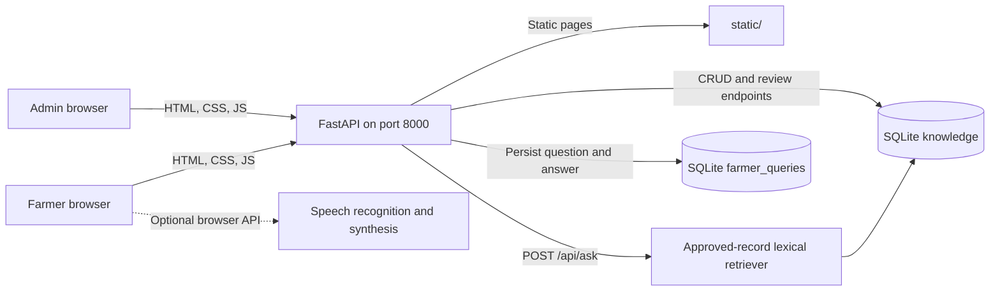

# Architecture

## System overview

## Request flow

1. The farmer submits typed text or a browser speech-recognition transcript,
   along with a selected language.
2. FastAPI rejects very short input and bypasses retrieval for live-information
   intents such as weather and market prices.
3. The retriever compares meaningful question tokens with the title, category,
   and curated keywords of **approved** SQLite records. It does not search
   answer prose, which reduces accidental matches on generic wording.
4. A match returns the corresponding answer, source label, publication date,
   content version, and a lexical-match indicator. Otherwise, a language-aware
   safe fallback is returned.
5. The question and response are written to `farmer_queries` for the admin
   dashboard.

## Components and trust boundaries

- **Browser:** static pages and native browser speech APIs. Speech availability
  and language quality depend on the user's browser, installed voices, device,
  permissions, and network. Audio is not sent to this server.
- **FastAPI:** page serving, validation, retrieval, and admin CRUD.
- **SQLite:** local persistence for content and query history; edits increment a
  record version. Existing databases receive a non-destructive `version`
  column migration on startup.
- **Admin page:** intended for local demonstration only. It has no login,
  authorization, audit identity, CSRF protection, or deployment hardening.

## Deliberate scope limits

There is no model inference, WhatsApp adapter, speech-to-text server, translation
service, weather feed, mandi-price feed, or scheme-eligibility integration.
The demonstration records have not been independently reviewed as agronomic
advice. Do not deploy this prototype as a production advisory service.
